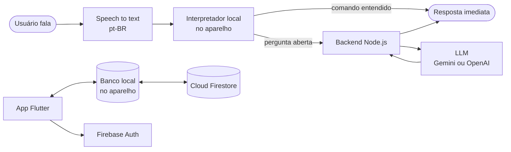

<div align="center">


# 📖 Livro de Receitas

**App em Flutter para organizar receitas e cozinhar com um assistente por voz.**
Trabalho de Conclusão de Curso · Ciência da Computação · UNIMAR


</div>

## ✨ Destaques
- **Assistente culinário por voz:** a pessoa fala livremente sobre a receita enquanto cozinha. Comandos simples são entendidos no próprio aparelho, sem internet; perguntas abertas (substituições, técnicas) vão para um LLM.
- **Funciona offline:** sem backend ou sem internet, o app continua funcionando com o interpretador local e o banco no aparelho.
- **Receitas na nuvem por usuário:** login por e-mail e senha (Firebase Auth) e sincronização com o Cloud Firestore.
- **Organização e preparo:** cadastro com ingredientes e modo de preparo, categorias (salgados, doces, bebidas) e checklist interativo durante o preparo.
- **Multiplataforma:** Android, iOS, Web, Windows, macOS e Linux.

## 🏗️ Arquitetura



As chaves do LLM ficam somente no backend (arquivo `.env`, fora do Git). O app nunca as recebe.

## 📂 Estrutura

```
livro_de_receita/
├── lib/          # App Flutter (telas, dados, assistente de voz)
├── backend/      # API Node.js que conversa com o LLM
├── firebase/     # Regras do Firestore e testes das regras
└── docs/         # Documentação técnica
```

## 🚀 Como rodar
O passo a passo completo está em [INICIALIZAR_PROJETO.md](livro_de_receita/docs/INICIALIZAR_PROJETO.md).

## 📚 Documentação
- [Assistente de voz](livro_de_receita/docs/ASSISTENTE_DE_VOZ.md)
- [Banco de dados](livro_de_receita/docs/DATABASE.md)
- [Firebase](livro_de_receita/docs/FIREBASE.md)
- [Diagramas](livro_de_receita/docs/DIAGRAMAS.md)
- [Relatório de testes](livro_de_receita/docs/testes/RELATORIO.md)
- [README técnico do app](livro_de_receita/README.md)

## 👤 Autor
**Raul Mozart Andrade Bertoncini** · [LinkedIn](https://www.linkedin.com/in/raul-mozart-andrade-bertoncini-853b12265/) · [GitHub](https://github.com/Raul-Mozart)
