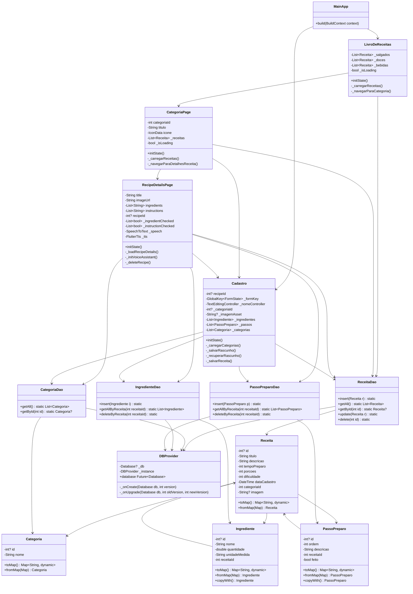
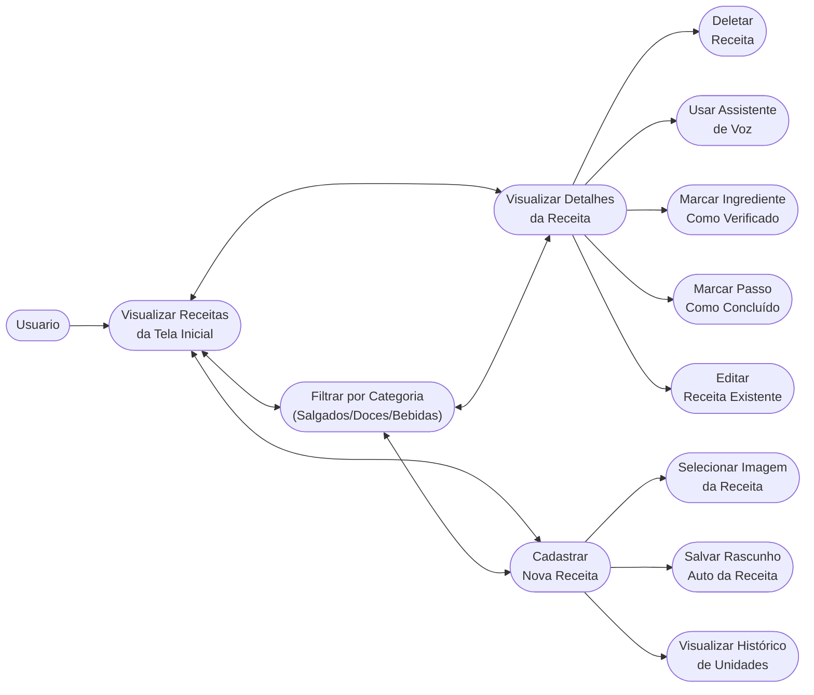
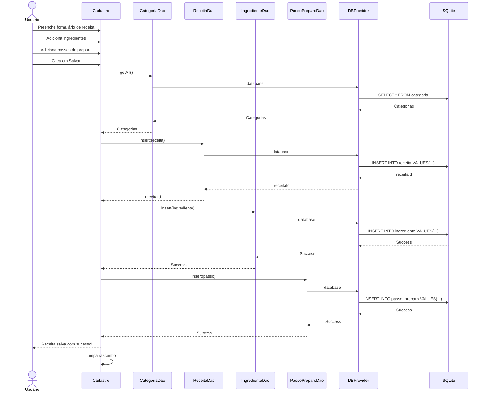
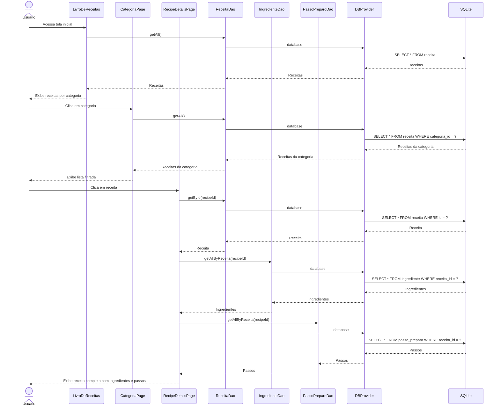
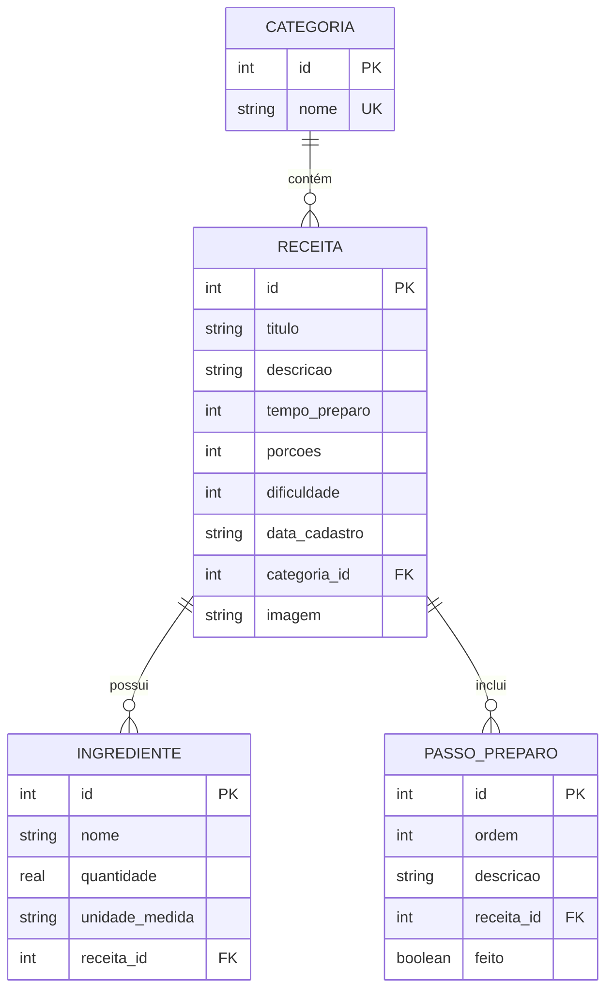
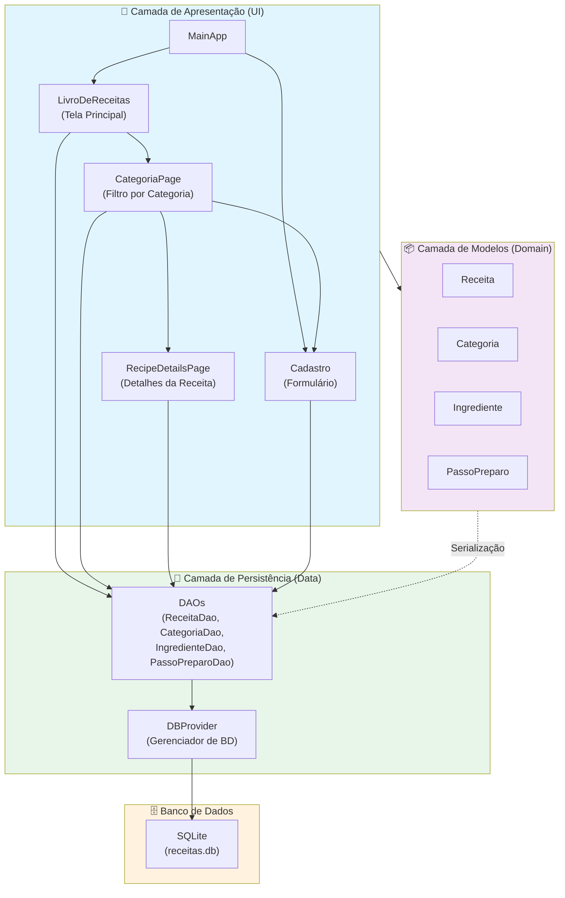
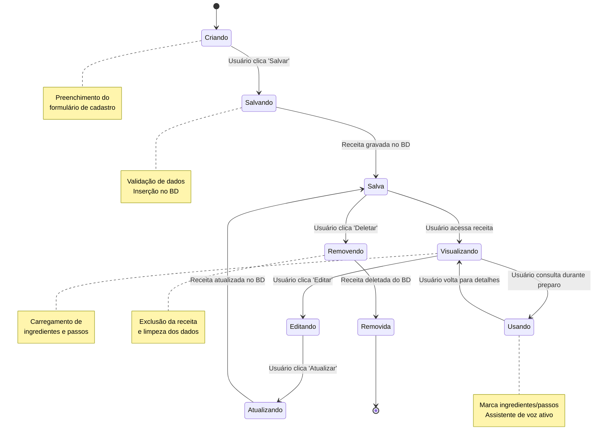

# 📊 Diagramas UML - Livro de Receitas

## 📐 1. Diagrama de Classes



---

## 🎭 2. Diagrama de Casos de Uso



---

## 🔄 3. Diagrama de Sequência - Fluxo de Cadastro de Receita



---

## 🔄 4. Diagrama de Sequência - Fluxo de Visualização de Receita



---

## 📝 5. Diagrama de Entidade-Relacionamento (ER) - Banco de Dados



---

## 🏗️ 6. Diagrama de Arquitetura em Camadas



---

## 📊 7. Diagrama de Estados - Ciclo de Vida de uma Receita


```


---

## 🔑 Componentes-Chave

### Padrões de Design Utilizados:

1. **Singleton Pattern**: `DBProvider` (garante única instância do BD)
2. **DAO Pattern**: `ReceitaDao`, `CategoriaDao`, etc. (abstrai acesso ao BD)
3. **Model Pattern**: Classes de modelo com `toMap()` e `fromMap()` (serialização)
4. **Stateful Widget Pattern**: Páginas que gerenciam estado local (Flutter)

### Fluxo Principal de Dados:

```
Usuário Input → Widget (UI) → DAO Layer → DBProvider → SQLite Database
SQLite Database → DBProvider → DAO Layer → Model Objects → Widget (UI) → Usuário
```

### Dependências Críticas:

- 🔴 **Receita** depende de **Categoria** (categoria_id)
- 🔴 **Ingrediente** depende de **Receita** (receita_id)
- 🔴 **PassoPreparo** depende de **Receita** (receita_id)

---

## 📱 Principais Funcionalidades

| Funcionalidade | Componentes | Fluxo |
|---|---|---|
| **Listar Receitas** | LivroDeReceitas → ReceitaDao | getAll() → Exibição por categoria |
| **Filtrar por Categoria** | CategoriaPage → ReceitaDao | WHERE categoria_id → getAll() filtrado |
| **Visualizar Detalhes** | RecipeDetailsPage → Todos DAOs | getById() + getAllByReceita() |
| **Cadastrar** | Cadastro → ReceitaDao + IngredienteDao + PassoPreparoDao | insert() transacional |
| **Editar** | Cadastro → ReceitaDao.update() | UPDATE receita |
| **Deletar** | RecipeDetailsPage → ReceitaDao.delete() | DELETE + cascata de FK |
| **Assistente de Voz** | RecipeDetailsPage → SpeechToText + FlutterTts | Marca items + Feedback auditivo |
| **Rascunho Auto** | Cadastro → File I/O | JSON local storage |

